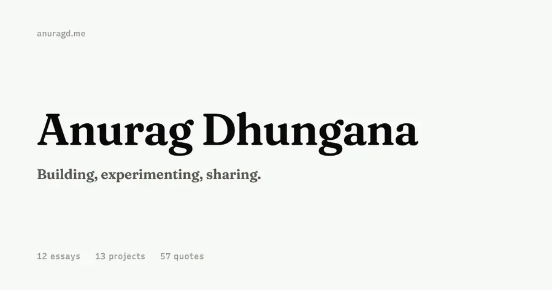

## Anurag Dhungana

I like building useful tools, agent systems, and weird little experiments. Software engineer on agentic infrastructure at **Wealth Architect** · MSCS @ GWU · Washington, DC.

[anuragd.me](https://www.anuragd.me) · [/now](https://www.anuragd.me/now) · [/blog](https://www.anuragd.me/blog) · [/uses](https://www.anuragd.me/uses) · [LinkedIn](https://www.linkedin.com/in/anuragdhungana) · [anurag@anuragd.me](mailto:anurag@anuragd.me)

### Now

<!-- now:start -->
I’m working at Wealth Architect, focused on harness engineering for conversational agents and financial agents.

Reading *The Complete Sherlock Holmes Collection*.

From [/now](https://www.anuragd.me/now), updated September 27, 2026.
<!-- now:end -->

### Building

- **[Transit MCP](https://github.com/Aarekaz/transit-mcp)** ([live](https://transit-mcp.anuragd.me/)) — connects AI agents to live DC Metro and NYC Subway arrivals, incidents, and train positions. ~2K people use it daily. Cloudflare Workers · OAuth 2.1.
- **[Dispatch](https://github.com/Aarekaz/dispatch)** *(in development)* — a self-hostable control plane for deployable agents: isolated sandboxes, chat, tool traces, channels, files, and scheduled runs.
- **[Shrimp](https://github.com/Aarekaz/shrimp)** *(wip)* — open-source agent harness. ReAct loop, event bus, capability registry, approval gate. The model is the brain, Shrimp is the body.
- **[SwitchBoard](https://github.com/Aarekaz/switchboard)** ([npm](https://www.npmjs.com/package/@aarekaz/switchboard)) — write one AI bot and run it on Slack, Teams, Google Chat, and Discord.
- **[Raindrop MCP](https://github.com/Aarekaz/raindrop-mcp)** ([live](https://raindrop-mcp.anuragd.me/)) — MCP server for Raindrop.io bookmarks, collections, tags, and highlights.
- **[Session Base](https://www.sessionbase.ai/)** ([CLI](https://github.com/sessionbase/cli)) — capture, organize, and share sessions across coding-agent platforms.

<b>Smaller things</b>

 

- **[Termweather](https://termweather.anuragd.me/)** (`npm i -g termweather`) — weather in your terminal: CLI, TUI, and site.
- **[Commit Grove](https://commit-grove.vercel.app/)** — grows your GitHub contribution graph into a 3D forest or city.
- **[Runwayr](https://github.com/Aarekaz/runwayr)** — headcount and runway planner, with a casino mode for seeing how fast a hiring plan kills a startup.
- **[FlowWrite](https://flowwrite.anuragd.me/)** — distraction-free writing, fully local.
- **[SplitSimple](https://splitsimple.anuragd.me/)** — easy bill splitting for groups.
- **[SEAS Search](https://seas-search.vercel.app/)** — Graph-RAG over GWU SEAS courses with Llama 3.1.
- **[Personal API](https://github.com/Aarekaz/api)** — Cloudflare Workers + D1 + R2. Everything on anuragd.me, including this README, is read from it.

### Writing

<!-- writing:start -->
- [From an empty file](https://www.anuragd.me/blog/from-an-empty-file) · Sep 2026
- [Harness engineering](https://www.anuragd.me/blog/agent-harnesses-explained) · Jun 2026
- [the brain is easy. the body is hard.](https://www.anuragd.me/blog/the-brain-is-easy-the-body-is-hard) · Apr 2026
- [tinkering](https://www.anuragd.me/blog/tikering) · Jan 2026

[All writing →](https://www.anuragd.me/blog)
<!-- writing:end -->

### Career

| Year | What |
|---|---|
| 2026 | Software Engineer, Agentic Infrastructure @ **Wealth Architect** · MSCS @ **GWU** |
| 2025 | ML Engineer @ **Cheers (YC S24)** — agent orchestration · Founder University, cohort 9 |
| 2023 | Co-founded **AfterLaunch** (150+ builders) · Operations Engineer @ **flockfysh** |
| 2022 | Product Manager @ **Ivy Apps** — grew installs 40K → 70K |
| 2020 | **CloudFactory** — data engineering, three promotions in four years |

**Stack:** TypeScript · Next.js · React · Cloudflare Workers · D1 · R2 · MCP · Python · PyTorch · LangChain · FastAPI · PostgreSQL · AWS

**Off-keyboard:** 🏎️ Formula 1 · 📷 [photography](https://www.anuragd.me/photography) · 🚴 cycling · 📚 [the shelf](https://www.anuragd.me/shelf)

Now and Writing update daily from anuragd.me.
